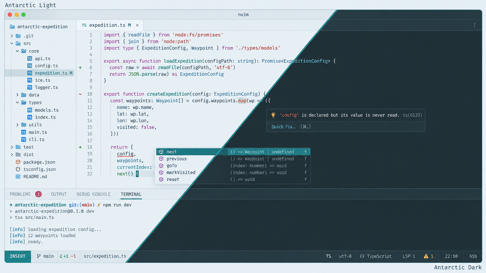

# Antarctic for Neovim

Light and dark themes based on the shared [Antarctic palette](https://github.com/AntarcticTheme/.github/blob/main/profile/README.md).



## Requirements

Install [Neovim](https://github.com/neovim/neovim/blob/master/INSTALL.md) 0.9+ and [Git](https://git-scm.com/downloads). 

Use a true-color terminal. 

The theme is a runtime plugin, no separate theme binary or language plugins are required.

## Install

Clone into Neovim's native start-package directory (the default Linux data path):

```sh
git clone https://github.com/AntarcticTheme/Neovim.git "$HOME/.local/share/nvim/site/pack/themes/start/antarctic"
```

On macOS, Windows, or installations with a custom data path, run `:echo stdpath("data")` in Neovim, then clone into `<that path>/site/pack/themes/start/antarctic`. 

Keep both `colors/` and `lua/`. Restart Neovim after installation.

Run `:echo stdpath("config")` to locate the directory containing `init.lua`. Create that directory and file if they do not exist.

Add to `init.lua`:

```lua
vim.cmd.colorscheme("antarctic-dark")
```

Use `antarctic-light` for light mode. You can also switch using `:colorscheme antarctic-light` or `:colorscheme antarctic-dark`.

### lazy.nvim

Insert this specification into your existing lazy.nvim plugin list instead of using the native installation:

```lua
{
  "AntarcticTheme/Neovim",
  lazy = false,
  priority = 1000,
  config = function()
    vim.cmd.colorscheme("antarctic-dark")
  end,
}
```

### LazyVim

Create `lua/plugins/antarctic.lua` inside your Neovim configuration directory:

```lua
return {
  {
    "AntarcticTheme/Neovim",
    lazy = false,
    priority = 1000,
  },
  {
    "LazyVim/LazyVim",
    opts = {
      colorscheme = "antarctic-dark",
    },
  },
}
```

Restart Neovim and run `:Lazy sync`. Use `antarctic-light` for light mode. This replaces the standalone lazy.nvim example above when using LazyVim.

### Coverage

Includes classic syntax, Tree-sitter captures, LSP semantic tokens, diagnostics, diff and search views, terminal ANSI colors, and highlights for Telescope, nvim-cmp, Gitsigns, NvimTree, Neo-tree, Lazy, and WhichKey. Plugins and language parsers are optional and installed separately.

## Distribution and updates

Downloads use this port's `main` branch on GitHub. To install a fixed version, replace `main` in raw download URLs with a published tag or commit SHA. If downloading in your browser, open the file on GitHub and use **Download raw file**; save the original filename, not the GitHub HTML page. You can also use **Code → Download ZIP**, extract it, and copy the theme files to the installation directory above.

For the Git installation, update with `git -C /full/path/to/antarctic pull --ff-only`. 

For lazy.nvim, use its update command.

Released under the MIT license. See [LICENSE](LICENSE).
